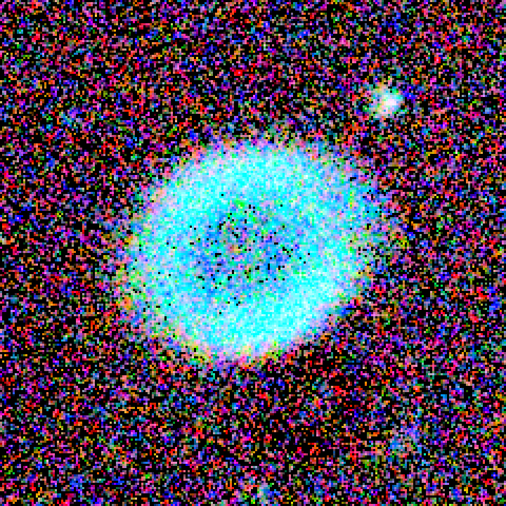
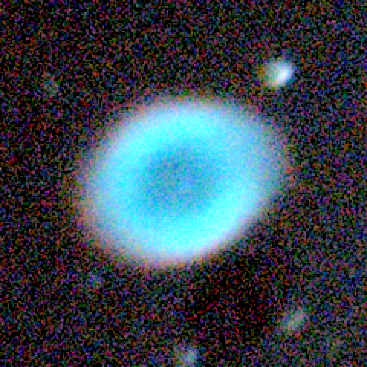
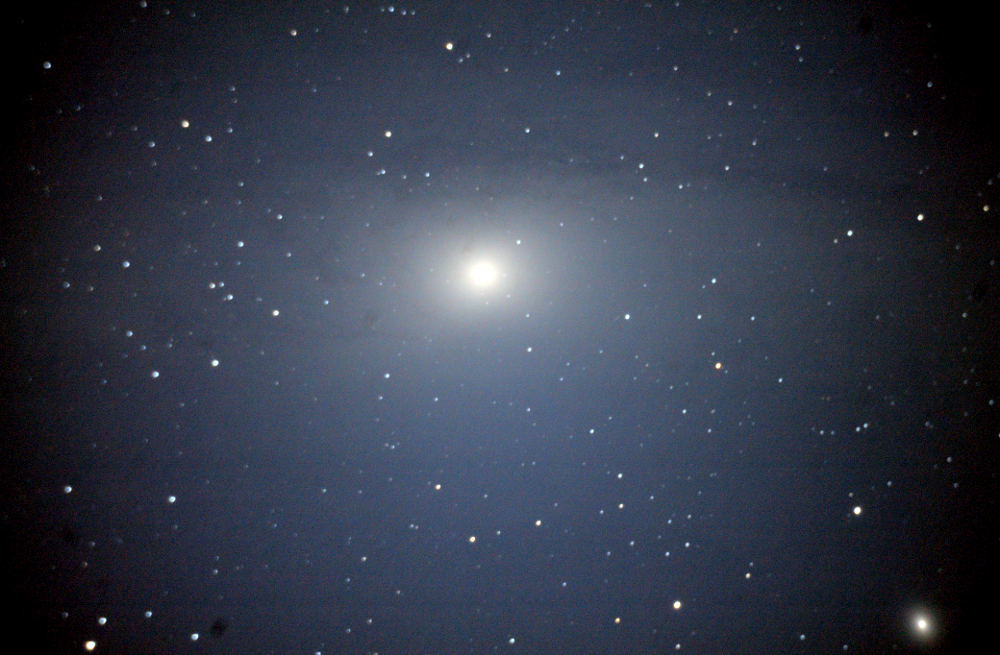
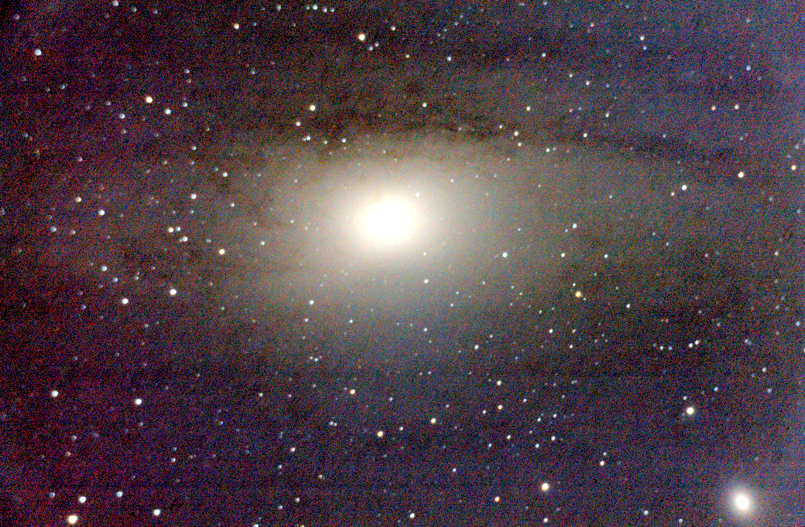

# Astro Stacker

> **Work in Progress (WIP):** This project is actively evolving and not yet a finished, general-purpose release (for example, sensor geometry is currently hardcoded to Canon EOS 1100D `.CR2` frames, and CLI/packaging/UI details may still change).
>
> **Development Note:** Much of the C++20 implementation, evaluation harness, and documentation was **heavily AI-assisted** (making it possible to build in limited spare time) and **human-directed & validated** against real astrophotography data. Read the full story behind how this was built in the companion blog post: [Hill-Climbing an Astro Stacker with Carbon](https://jrmlhermitte.github.io/2026/11/26/hill-climbing-an-astro-stacker-with-carbon.html).

A fast, pure-CPU **C++20 / OpenMP** deep-sky astrophotography stacking engine for raw DSLR exposures.

Built from first principles to recover faint deep-sky signal near the Poisson sky floor amidst unguided mount drift, celestial field rotation, outdoor sensor cooling, sensor-locked dust motes, optical vignetting, and corrupted raw bitstreams.

| Single Raw Reference (M57 Ring Nebula) | Stacked Output (`astro_stacker`) |
| :---: | :---: |
|  |  |

| Unflattened Stack (M31 Andromeda) | Blind Synthetic Flat-Fielded Stack |
| :---: | :---: |
|  |  |

---

## Features

- **Strict RAW Validation & Partial-Row Salvage** — Thread-safe `LibRaw` decoding with lossless-JPEG bitstream validation, 14-bit ADC sanity gates, and row-level salvage for partially corrupted exposures.
- **Thermal-Aware Dark Calibration** — Per-row optical-black pedestal smoothing, temporal Winsorized Sigma-Clipped master dark, and per-frame hot-site thermal dark scaling ($\alpha$).
- **Linear RGGB Demosaicing** — Exact 5x5 Malvar–He–Cutler linear demosaicing without floor clipping.
- **Geometric Hashing Registration** — Autonomous sharpest-frame selection, Valdes chiral triangle geometric hashing, 4-DOF similarity / 6-DOF affine refinement, photometric flux scaling, and PSF/SNR frame weighting.
- **Synthetic Sensor-Space Flat-Fielding** — Optional blind estimation of radial optical vignetting and sensor-locked dust motes directly from light frames (with save/load support for cross-target flat calibration).
- **High-Fidelity Integration** — Partition-of-unity Lanczos-3 resampling, differential planar sky matching, and per-pixel temporal Winsorized Sigma Clipping.
- **Multiple Export Formats & Machine-Readable Telemetry** — Exports 32-bit IEEE-754 linear TIFF, 16-bit auto-stretched preview TIFF, 32-bit linear FITS, NumPy `.npy`, and JSON registration transforms, while emitting structured JSON run telemetry to `stdout`.

---

## Requirements

- Linux (tested on Ubuntu) with a C++20 compiler (`g++ >= 10` or `clang++ >= 12`)
- OpenMP (included with `g++`)
- `libraw` development headers (`libraw_r`)
- `make` or `cmake >= 3.16` (with `pkg-config` for CMake)

### Install Dependencies on Ubuntu / Debian

```bash
sudo apt update
sudo apt install -y g++ make libraw-dev
```

*(Optional, if building with CMake: `sudo apt install -y cmake pkg-config`.)*

---

## Build & Install

### Using Make (Recommended)

```bash
make -j$(nproc)
```

The binary is built at `cpp_stacker/build/astro_stacker`.

To install system-wide (defaults to `/usr/local/bin/astro_stacker`):

```bash
sudo make install
```

For portable binaries without host-specific `-march=native` instructions (e.g., for `.deb` packaging):

```bash
make PORTABLE=1 -j$(nproc)
```

### Using CMake

```bash
cmake -B build -DCMAKE_BUILD_TYPE=Release
cmake --build build -j$(nproc)
```

Pass `-DASTRO_NATIVE_ARCH=OFF` for portable builds.

---

## Quick Start

Stack a directory of raw light `.CR2` frames using a directory of dark `.CR2` frames:

```bash
./cpp_stacker/build/astro_stacker \
  --lights /path/to/lights \
  --darks /path/to/darks \
  --out-tif stack_linear32.tif \
  --out-preview-tif stack_preview16.tif
```

Enable synthetic sensor-space flat-fielding (removes radial vignetting and dust motes without separate twilight/panel flat frames):

```bash
./cpp_stacker/build/astro_stacker \
  --lights /path/to/lights \
  --darks /path/to/darks \
  --flat-mode full-iter \
  --save-flat session_flat.npy \
  --out-fits stack.fits \
  --out-preview-tif stack_preview16.tif
```

Reuse a saved session flat on another target from the same optical train:

```bash
./cpp_stacker/build/astro_stacker \
  --lights /path/to/other_target_lights \
  --darks /path/to/darks \
  --load-flat session_flat.npy \
  --out-tif other_target_linear32.tif \
  --out-preview-tif other_target_preview16.tif
```

---

## CLI Reference

Run `astro_stacker --help` to view all options.

| Flag | Required | Description |
| :--- | :---: | :--- |
| `--lights <dir>` | Yes | Directory containing raw light `.CR2` exposures |
| `--darks <dir>` | Yes | Directory containing raw dark `.CR2` exposures |
| `--out-tif <file.tif>` | * | 32-bit IEEE-754 linear RGB TIFF |
| `--out-preview-tif <file.tif>` | * | 16-bit auto-stretched RGB preview TIFF (for quick viewing) |
| `--out-fits <file.fits>` | * | 32-bit IEEE-754 linear RGB FITS cube (`NAXIS1=W, NAXIS2=H, NAXIS3=3`) |
| `--out-npy <file.npy>` | * | 32-bit float RGB NumPy array of shape `(H, W, 3)` |
| `--out-transforms <file.json>` | * | Per-frame registration transforms, inlier counts, and weights |
| `--ref-frame <filename>` | No | Pin a specific light frame as the coordinate reference (default: auto-select sharpest) |
| `--flat-mode <mode>` | No | Synthetic flat mode: `none` (default), `motes-self`, `motes-iter`, `full-self`, `full-iter` |
| `--flat-chroma <mode>` | No | Flat chromaticity: `coupled` (default) or `per-channel` |
| `--flat-iters <N>` | No | Iterations for `motes-iter` / `full-iter` (default: `3`) |
| `--save-flat <file.npy>` | No | Save the estimated synthetic flat field to a `.npy` file |
| `--load-flat <file.npy>` | No | Load and apply an existing flat field `.npy` file |
| `-h`, `--help` | No | Show usage and exit |
| `-v`, `--version` | No | Show version and exit |

*\* At least one `--out-*` flag must be specified.*

On completion, `astro_stacker` prints a structured JSON summary to `stdout` (frame counts, selected reference, flat-field statistics, and per-stage wall-clock timings), making it straightforward to wrap in scripts or a future UI.

---

## Current Scope & Roadmap

> **Camera Support Note:** The current `1.0.0` release enforces Canon EOS 1100D 14-bit RGGB sensor geometry (`4352 x 2874` raw / `4290 x 2856` active; see [`cpp_stacker/include/types.hpp`](cpp_stacker/include/types.hpp)).

Planned next steps:
- [ ] Generalize sensor geometry, CFA pattern, and optical-black margin extraction dynamically via `LibRaw` for arbitrary DSLR/mirrorless cameras (`.CR2`, `.CR3`, `.NEF`, `.ARW`, `.DNG`)
- [ ] Ubuntu Debian packaging (`.deb` / PPA)
- [ ] Interactive UI (desktop, web, or mobile frontend driving the `astro_stacker` core)

---

## Repository Layout

```text
.
├── Makefile                # Top-level build & install wrapper
├── CMakeLists.txt          # CMake build configuration
├── cpp_stacker/            # C++20/OpenMP stacking engine (include/, src/, Makefile)
├── paper/                  # Research paper (LaTeX source, figures, compiled PDF)
├── scripts/                # Pure-NumPy evaluation harness, torture tests, figure scripts
├── docs/                   # Development research notes and baseline analysis
└── legacy_2020/            # Archived 2020 Python prototype referenced in the paper
```

---

## Research Paper, Blog Post & Evaluation

- **Blog Post:** [Hill-Climbing an Astro Stacker with Carbon](https://jrmlhermitte.github.io/2026/11/26/hill-climbing-an-astro-stacker-with-carbon.html) — overview of the AI-assisted, human-validated development workflow and results.
- **Technical Paper:** [`paper/astro_stacker_paper.pdf`](paper/astro_stacker_paper.pdf) — the full write-up covering the postmortem of the [`legacy_2020/`](legacy_2020/README.md) prototype, raw bitstream forensics, the 28-test adversarial evaluation harness (`scripts/evaluate.py`), evolutionary optimization results on M57 and holdout M31, and synthetic flat-fielding.

---

## License

Copyright (C) 2020–2026 Julien Lhermitte.

This project is licensed under the **GNU General Public License v3.0** — see the [LICENSE](LICENSE) file for details.
